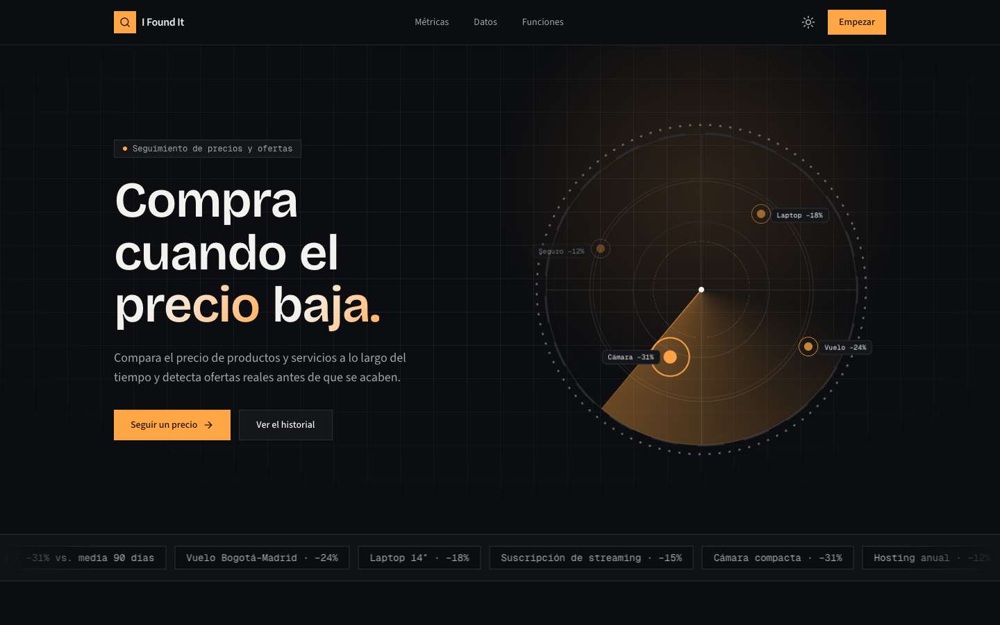
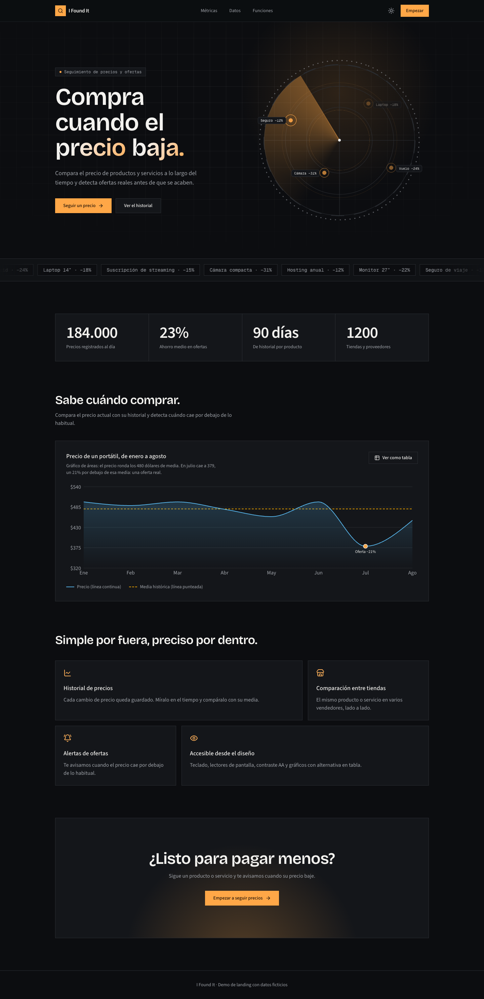

# 🔎 Vida lo encontre! ( i-found-it-app )

[](https://github.com/vida-I-found-it/foundit-web-app/actions/workflows/ci.yml)
[](https://react.dev/)
[](https://www.typescriptlang.org/)
[](https://vite.dev/)
[](https://tailwindcss.com/)
[](https://vitest.dev/)
[](https://pnpm.io/)
[](https://nodejs.org/)
[](compose.yaml)
[](LICENSE)

SPA de visualización de datos para comparar precios de productos y servicios a lo largo del tiempo y detectar ofertas. Dashboard minimalista, accesible y rápido.

## 🎯 Objetivo

Ser la **cara del producto**: que cualquier persona cree una alerta con las páginas de un producto y sus correos, la
consulte por su número y, más adelante, vea cómo cambió el precio. Es la única pieza que se publica al navegador; todo lo
demás es privado. No guarda datos ni secretos: habla solo con `core-service` por REST, valida lo que escribe el usuario y
muestra cada error en lenguaje claro y accesible.

## 🧰 Tecnologías (lo que usa hoy)

| Tecnología | Para qué |
|---|---|
| **React 19** + **TypeScript** (strict) | Interfaz por *features* (`landing` y `board`) con tipos estrictos |
| **Vite 8** | Servidor de desarrollo y build de producción; `VITE_API_BASE_URL` se fija al compilar |
| **Tailwind CSS 4** | Estilos con tokens de diseño; sin colores sueltos en los componentes |
| **Recharts** · **Motion** · **lucide-react** | Gráficos, animación opt-in e íconos |
| **Vitest** + **Testing Library** | Pruebas de componentes y de los clientes REST |
| **pnpm 11** + **Node 24** | Dependencias con lockfile y entorno fijado en `package.json` |
| **Docker** + **Compose** | Imagen de dos etapas: compila con pnpm y sirve `dist/` sin root con un servidor estático propio |

La tabla «Stack objetivo» de más abajo es hacia dónde va el proyecto; varias piezas (TanStack, Zustand, Zod, shadcn,
Biome…) todavía no están instaladas.

## 🐳 Con Docker

```bash
docker compose up -d --build --wait   # http://127.0.0.1:5173
docker compose down
```

- La URL de `core` se fija al construir la imagen (`VITE_API_BASE_URL`, por defecto `http://127.0.0.1:8000`). Es el
  **navegador** el que llama a `core`, no el contenedor.
- Para tener una API funcionando, levanta también el compose de `core-service`. Sin él, las pantallas cargan y muestran el
  error de conexión.
- [`docker/serve.mjs`](docker/serve.mjs) sirve `dist/` solo con módulos de Node, sin dependencias. Hace lo mismo que
  `deploy/render/render.yaml`: devuelve `index.html` en las rutas del SPA, guarda en caché los `/assets` (inmutables) y nunca el HTML,
  añade cabeceras de seguridad, bloquea el *path traversal* y solo acepta `GET` y `HEAD`.
- Publica solo `127.0.0.1:5173`. Solo lectura, `cap_drop: ALL`, `no-new-privileges` y límites de memoria, CPU y procesos.

## Vista previa

Demo del landing (datos ficticios):



<details>
<summary>Ver la página completa</summary>



</details>

## Arquitectura del proyecto

### Principios

- **Minimalismo**: tipografía, rejilla, espacio en blanco y un solo color de acento. La identidad no depende de efectos.
- **Animación opt-in**: por defecto solo transiciones CSS cortas (150–200 ms). Motion se usa únicamente donde lo decidimos, y todo respeta `prefers-reduced-motion`.
- **Accesible por defecto**: WCAG AA como mínimo, verificado de forma automática en CI.

### Stack objetivo

| Capa | Elección |
|---|---|
| Build | Vite + React 19 + TypeScript (strict) |
| Routing | TanStack Router (file-based, con code-splitting por ruta) |
| Datos del servidor | TanStack Query sobre un cliente REST |
| Estado de UI | Zustand (solo estado local de interfaz) |
| Estilos y componentes | Tailwind CSS v4 + shadcn/ui (Radix) |
| Gráficos | shadcn Charts sobre Recharts (Apache ECharts como reserva para casos exigentes) |
| Tablas | TanStack Table + TanStack Virtual |
| Fechas y filtros | react-day-picker + date-fns |
| Mapa (si aplica) | MapLibre GL |
| Formularios | React Hook Form + Zod |
| Animación (opt-in) | CSS y Motion |
| Calidad | Biome, Vitest + Testing Library + vitest-axe, Playwright + @axe-core/playwright, Husky + lint-staged |
| Extras | vite-plugin-pwa, React Compiler |

### Comunicación con el backend

Por ahora la app se comunica únicamente por **REST**. Todas las llamadas pasan por el cliente HTTP de `src/lib/`, y cada *feature* expone sus funciones y hooks de Query en su carpeta `api/`. Los esquemas Zod validan las respuestas, así la UI nunca depende de datos sin validar. Si el backend cambia, solo se toca esa capa.

### Estructura de carpetas

```
src/
  app/          # providers, router, layout raíz, estilos globales
  routes/       # definición de rutas (TanStack Router, file-based)
  features/     # un módulo por dominio
    <feature>/
      api/        # funciones REST y hooks de TanStack Query
      components/ # componentes propios del feature
      hooks/      # hooks propios del feature
      schemas/    # esquemas Zod y tipos derivados
    dashboard/    # vistas y widgets del dashboard
  components/   # UI compartida
    ui/           # componentes base (shadcn)
    charts/       # wrappers de gráficos con alternativa accesible en tabla
    layout/       # shell, navegación, contenedores
    motion/       # wrappers de animación opt-in
  lib/          # cliente HTTP, utilidades, configuración
  styles/       # tokens de diseño (colores OKLCH, tipografía, easing)
  test/         # setup y helpers de pruebas
```

### Dos zonas: landing y board

- **Landing** (`src/features/landing/`): página de presentación. Su botón «Ir al board» lleva al board.
- **Board** (`src/app/board/`): la aplicación, con su propio layout (cabecera y navegación). Todos los features de producto viven aquí.
- Hoy el ruteo es por hash (`#/` landing, `#/board/...` board) y está aislado en `src/lib/paths.ts` y `src/app/board/router.ts`. Pasar a un router real (el stack lo prevé) solo cambia esos dos módulos y `App.tsx`.

### Cómo agregar un feature (3 pasos)

1. Crear `src/features/<feature>/` con un `index.ts` que exporte la pantalla (`api/`, `components/`, `messages.ts`, `model.ts` según haga falta; ver `src/features/alerts/`).
2. Registrarlo en **un solo lugar**: `src/app/board/features.ts`, añadiendo un objeto a `boardFeatures` (`id`, `label`, `icon`, `path` y `component` cargado con `lazy`). La navegación y la ruta salen de ahí; usa `status: "soon"` para una entrada deshabilitada «Próximamente».
3. Construir la pantalla con los componentes compartidos de `src/components/` (`ui/`: `Button`, `Dialog`, `ErrorBanner`, `Notice`, `RepeatableField`, `TextAreaField`; `layout/`: `PageHeader`, `SkipLink`). Si un componente de tu feature resulta genérico, muévelo ahí. Los textos van en un `messages.ts` del feature, listo para i18n, y los tests en `tests/<feature>/`.

### Reglas

- Un *feature* no importa de otro *feature*. Solo importa de `components/` y `lib/`. El linter lo hace cumplir.
- El estado del servidor vive en TanStack Query; Zustand queda para estado de interfaz.
- Las rutas son delgadas: componen componentes de `features/` y definen *loaders*.
- Los tokens visuales (colores, tipografía, easing) viven en `styles/` y no se hardcodean en componentes.

### Gráficos y accesibilidad

- Todo gráfico se crea con los wrappers de `components/charts/`, que incluyen título, descripción textual (`aria-label`, `aria-describedby`) y un botón "Ver como tabla" con los mismos datos.
- El color nunca es el único canal de información: se suma forma, patrón o etiqueta directa.
- Paletas categóricas seguras para daltonismo (Okabe-Ito o Paul Tol), definidas en OKLCH y con contraste AA.
- Foco visible, orden de tabulación lógico y modo oscuro con contraste verificado.
- Las pruebas de accesibilidad (`vitest-axe` en componentes y `@axe-core/playwright` en E2E) se ejecutan en CI y un fallo rompe el build.
